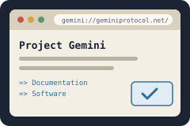

  

# Gemini browser

  

Didn't work? Create a Studio workspace and paste this to your agent:
` /use-template https://github.com/boweiliu/gemini-browser-template`

## Why you care

Gemini is a small, text-first corner of the internet that ordinary browsers cannot open. This puts a Gemini browser in a
Studio window, so you can read capsules, follow links and answer prompts without installing anything, and so can each
person your workspace is shared with, with a history and saved certificates of their own.

## How to use it

Open **Gemini browser** from the desktop, type an address such as `geminiprotocol.net` and press Enter.

- **Read and follow.** Headings, links, lists, quotes and preformatted blocks render as a clean page; images show
  inline and other files get a download link. "View source" shows the original page text.
- **Answer prompts.** Pages that ask for input (status 10) take your answer in the address; secret prompts (status 11)
  are sent by POST so the answer never appears in an address or a log.
- **Certificates.** A site's certificate is remembered the first time you visit (trust on first use). If it later
  changes, the page stops and asks before you trust the new one.
- **Recent pages.** The start page lists the pages you opened, newest first; before you have visited anything it offers
  two places to start (Project Gemini and the Kennedy search engine).
- **Shared workspaces.** The owner browses any address. Visitors browse public addresses only, each with a profile of
  their own; the owner can name extra hosts for visitors in `GEMINI_BROWSER_VISITOR_HOSTS`.

It needs outbound TCP on port 1965. Check:
`printf 'gemini://geminiprotocol.net/\r\n' | openssl s_client -connect geminiprotocol.net:1965 -servername geminiprotocol.net -quiet`
prints a first line `20 text/gemini`.

Tests: from `system/apps/gemini_browser`, `uv run --no-sync pytest -m ''`. They run against a local fake Gemini server
with no internet.

Known gaps: no client certificates and no per-person rate limits.

## Ideas for making it yours

- Change the two starting points on the start page to the capsules you read most.
- Add a bookmarks page next to the recent-pages list, kept per person like the history.
- Name your own capsule for visitors through `GEMINI_BROWSER_VISITOR_HOSTS` so people you share the workspace with can
  open it.
- Add a per-person rate limit so a shared workspace cannot be used to hammer one server.
- Add client certificate support (statuses 60 to 62), saved per person.

## Install it as its own repo

The template keeps the app under `system/apps/gemini_browser/` (its published state). After you adopt it, give the
installed copy a repository and a history of its own, separate from the workspace's. Run these steps in order from the
workspace root.

1. **Move the app out of the workspace tree.** Copy `system/apps/gemini_browser/` (it carries its tests and docs) into
   a new directory `.external_worktrees/gemini-browser/`, with the package at the root: `app.toml`, `icon.svg`,
   `pyproject.toml`, `src/`, `docs/` and the test files beside them. Do not copy `.git` or `.venv`.
2. **Point it at the workspace's libraries and give it its own history.** In that copy, change the `app-schema` line
   under `[tool.uv.sources]` in `pyproject.toml` from `../../libs/app_schema` to `../../system/libs/app_schema`, then
   run `uv lock` there. Then `git init -b main` in `.external_worktrees/gemini-browser/` and make one first commit. Do
   not fetch, clone or merge anything from the template into it.
3. **Optional: a private GitHub repo for it.** Create your own private repository (`POST /user/repos` through
   latchkey, with no `auto_init`, `"private": true`) and push `main` through the gateway. Or keep it local only. Say
   which you chose.
4. **Wire config only.** Edit `system/supervisord.conf.d/gemini-browser.conf` so its command syncs and runs the app
   from the clone: `ensure-project` and `uv sync --locked --project .external_worktrees/gemini-browser`, then
   `forward_port.py --manifest .external_worktrees/gemini-browser/app.toml --url http://localhost:8081`, then
   `exec .external_worktrees/gemini-browser/.venv/bin/gemini-browser`. Then run
   `supervisorctl reread && supervisorctl update`.
5. **Remove the app's code from the workspace tree.** `git rm -r system/apps/gemini_browser` and commit. The
   supervisord file stays; it now points at the clone. `.external_worktrees/` is ignored by the workspace's own git, so
   the clone's history lives only in its own repository.
6. **Check that it separated.** `git -C .external_worktrees/gemini-browser log --oneline` lists only the app's own
   commit or commits; `ls system/apps/gemini_browser` fails; and `curl -s http://127.0.0.1:8081/health` answers
   `{"status":"ok"}`, served from the clone.

## What this is

This repository is a published **Imbue Studio template**: a clean, bootable
snapshot of what an agent built, ready to adapt into your own. It is NOT the
generic workspace template -- it is this specific project.

[`template.md`](template.md) is the full manifest -- what it is, how it
works, what it needs to run, and what to adapt -- with the
machine-readable half (recipe, requirements, and the environment it needs
installed) in [`template.toml`](template.toml).
